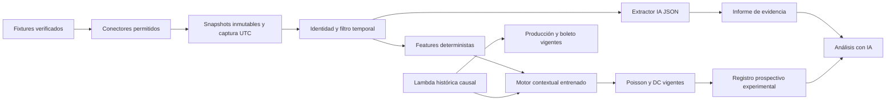

# Kuota — Fase 5, Etapa A: auditoría y arquitectura contextual

Fecha de investigación: 11 de octubre de 2026. Estado: diseño para aprobación; sin implementación, contratación, PR nuevo, merge ni despliegue.

## 1. Dictamen

La Fase 5 es viable como sistema experimental en shadow mode, con un camino separado de producción. Hoy no hay evidencia suficiente para entrenar y validar efectos de lesiones, alineaciones o noticias. Primero deben existir fixtures verificables y snapshots prospectivos durables. La ausencia de contexto o de coeficientes entrenados debe producir abstención y conservar exactamente la predicción base.

Recomiendo un prototipo con API-Football como primera opción de evaluación de identidad/calendario, Open-Meteo para captura de pronósticos y un extractor IA restringido a evidencia archivada. La recomendación es condicional a cobertura real por liga/temporada, derechos de conservación y credenciales aportadas posteriormente. No se han probado APIs autenticadas ni se presupone acceso. Sportmonks queda como alternativa para un piloto comparativo, especialmente por sus datos de indisponibilidad; no se ha demostrado que ninguna de las dos opciones entregue versiones históricas as-of de lesiones/alineaciones.

Primer candidato: Poisson contextual sobre lambdas de producción congeladas como offset. La referencia regularizada de Fase 3 seguirá separada. Ningún resultado de esta Etapa A demuestra una mejora predictiva contextual.

## 2. Base auditada y componentes existentes

Repositorio: [Erixfer98/laliga-modelo](https://github.com/Erixfer98/laliga-modelo). Main remoto verificado: `768bd375ddfa6e37b35a28c8555768686e455bff`, merge del [PR #5](https://github.com/Erixfer98/laliga-modelo/pull/5). El árbol local `8a03253` es idéntico a ese main (`git diff origin/main HEAD --exit-code` sin diferencias). La auditoría no cambió de rama ni modificó archivos del repositorio.

| Componente | Funcionamiento comprobado | Utilidad y límite para Fase 5 |
| --- | --- | --- |
| `generar_bbdd.py`, `espn.py` | Cinco ligas desde football-data.co.uk; Liga MX desde ESPN; CSV/XLSX normalizados | Fuente de resultados retrospectivos. No archiva respuestas ni historial de disponibilidad |
| `modelo.py` | Medias ponderadas, ataque/concesión por condición y lambdas multiplicativas | Mantener intacto; reconstruir su historial causal en el camino experimental |
| `probabilidades.py` | Poisson/DC, soporte dinámico, máscaras de liquidación, retornos, EV y Kelly | Reutilizar directamente; no duplicar fórmulas |
| `kuota.py`, `api.py` | Análisis, mercados, detalle y boleto | Producción continúa usando el modelo vigente |
| PR #5 | Cachés acotadas, versiones de datos/modelo, resumen/detalle separados y cancelación en web | El contexto se calcula fuera de este camino; las claves experimentales tendrán su propia versión |
| `evaluacion/` | Walk-forward diario, contratos de cohorte, scores y bootstrap semanal | Base para evaluación; extender claves con horizonte, proveedor y versión del protocolo |
| `experimentos/lambdas.py`, `temporal.py` | Encogimiento Poisson y selección temporal interna; NB condicionada por dispersión anterior | Referencia Fase 3 separada, no sustituto elegido a posteriori |
| `experimentos/registro.py` | SQLite append-only con bytes originales, hashes, cadena y hora efectiva | Reutilizar sin ampliar silenciosamente su contrato ni atribuir certificación externa |
| Next.js y autenticación actual | Enfrentamientos manuales, boleto persistente y API intermediada | Añadir sección optativa experimental; nunca convertir una combinación manual en fixture |
| `render.yaml` | API en plan free, uvicorn y autoDeploy existente | No declara disco durable para el registro ni worker programado; no iniciar shadow jobs allí |

La lambda local vigente es `ataque_casa(local) × defensa_fuera(visitante) × promedio_casa_liga`; la visitante usa `ataque_fuera(visitante) × defensa_casa(local) × promedio_fuera_liga`. Los pesos usan `exp(−0.005 × días)` y `K_ENCOGE=0`. Goles y goles 1T usan DC con `rho=−0.05`; las restantes métricas no. Los rangos 7×7 son sensibilidad heurística y no intervalos de cobertura validada.

`modelo.cargar()` no recibe un cutoff: cargar el CSV actual para simular un partido pasado introduciría resultados futuros. `evaluacion.temporal` sí filtra `fecha < fecha_predicción` y recalcula pesos. El nuevo generador debe usar una instantánea histórica elegible, nunca llamar sin más al endpoint actual para producir una base retrospectiva. También debe filtrar resultados realmente disponibles al cutoff: un partido anterior aún no finalizado no es historial utilizable. Con datos diarios sin hora de disponibilidad, excluir conservadoramente todo el día de predicción.

## 3. Inventario real y calidad de datos

Se leyeron los seis CSV y se ejecutó el contrato `evaluacion.datos.cargar()`. Total: **2.197 partidos**, 28 columnas por archivo. No hay celdas vacías ni filas completas duplicadas; pasan sus controles de conteos, tiros a puerta y goles por tiempo. Todas las filas tienen texto de hora UTC. Esto no verifica la exactitud del proveedor ni su publicación histórica.

| Liga | Partidos | Desde | Hasta | Temporadas |
| --- | ---: | --- | --- | --- |
| Bundesliga | 333 | 2025-08-22 | 2026-09-13 | 2025-26 / 2026-27 |
| LaLiga | 439 | 2025-08-15 | 2026-09-17 | 2025-26 / 2026-27 |
| Liga MX | 243 | 2026-01-09 | 2026-09-19 | Clausura / Apertura 2026 |
| Ligue 1 | 342 | 2025-08-15 | 2026-09-13 | 2025-26 / 2026-27 |
| Premier | 420 | 2025-08-15 | 2026-09-14 | 2025-26 / 2026-27 |
| Serie A | 420 | 2025-08-23 | 2026-09-14 | 2025-26 / 2026-27 |

Hallazgos que condicionan el diseño:

1. El último resultado es del 19 de septiembre; para una predicción futura hay que comprobar frescura y completitud, no presentar el archivo como actualizado al 11 de octubre.
2. Los CSV no conservan IDs oficiales de fixture/equipos, estadio, coordenadas, jugadores, lesiones, convocatorias, alineaciones, clima, cuotas ni timestamps de disponibilidad. `evaluacion/datos.py` fabrica un identificador de 24 caracteres a partir de liga, fecha y nombres: es una clave interna, no identidad oficial.
3. `fecha_dt` y `hora_utc_txt` están separados. Para Liga MX la fecha conservada es local y la hora UTC puede pertenecer al día siguiente; concatenarlas produciría kickoff incorrecto. `a_horas()` europeo también devuelve solo horas. No reutilizar estas columnas como certificado de kickoff UTC; recuperar timestamp completo del proveedor y mantener la zona original.
4. `jornada_val` es estimada, no jornada oficial. No usarla para clasificar finales, fases o importancia competitiva.
5. El scraping sobrescribe/republica datos; las revisiones no se versionan. ESPN usa valores iniciales cero en ciertos resúmenes y respalda tarjetas: ausencia de evento no siempre prueba un cero real. Los contratos numéricos no detectan ese problema semántico.
6. Deduplicación de ingesta por fecha/local puede ocultar colisiones; los IDs nuevos deben evitarla. El mapeo actual de nombres no acredita identidad entre proveedores.
7. Solo se cubren estas ligas, no todas las copas, competiciones continentales o selecciones. Un descanso derivado de este histórico es «desde el último partido de liga observado», no descanso real total. No alimentar congestión completa sin agenda de todas las competiciones relevantes.
8. Faltas existen en los CSV, pero Fase 2/3 excluyen esa métrica. Ampliar su evaluación sería un protocolo adicional, no extrapolación de los ocho experimentos anteriores.
9. No se encontró ninguna base `.sqlite` en el árbol inspeccionado ni capturas reales futuras documentadas. No se inspeccionaron sistemas privados externos ni secretos; no se afirma que el propietario carezca de otras fuentes.

Los hashes de los CSV deben adjuntarse al manifest de cada ejecución; el inventario reproducible usa `evaluacion.datos.inventario`. La validación existente `datos/validacion.json` corresponde al 20 de septiembre, no a una comprobación actual del proveedor.

## 4. Proveedores: investigación pública y decisión condicional

Precios consultados el 11 de octubre de 2026, sin compra. Impuestos, extras y condiciones pueden cambiar. Cobertura de una liga no equivale a cobertura completa de cada campo en cada temporada.

| Proveedor | Precio y límites publicados | Historia y as-of | Decisión |
| --- | --- | --- | --- |
| API-Football / API-Sports | Free 100 solicitudes/día; Pro USD19, 7.500/día; Ultra USD29, 75.000/día; Mega USD39, 150.000/día. Free limita temporadas; planes incluyen competiciones/endpoints | Resultados, fixtures, lesiones y alineaciones; no se verificó replay de versiones publicadas antes de un cutoff | Primer piloto de identidad/calendario; Pro solo si se autoriza acceso |
| Sportmonks | Starter EUR29/mes, 5 ligas, 2.000 llamadas por entidad/hora; sexta liga extra desde EUR4/mes. Growth EUR99, 30 ligas, 2.500/entidad/hora. Archivo de más de tres temporadas: extra desde EUR29 una vez; noticias desde EUR99/mes | `sidelinedHistory` y datos históricos no prueban publicación histórica; alineación esperada es distinta de confirmada | Alternativa: seis ligas desde EUR33/mes sujeto a paquete/cobertura; no comprar Growth por defecto |
| Open-Meteo | Free no comercial: 600/min, 5.000/hora, 10.000/día y 300.000/mes. Standard 1M/mes; Professional 5M/mes | API de pronósticos y runs; histórico comercial requiere Professional. La página consultada no mostró importe monetario actual verificable | Captura prospectiva primero; confirmar cotización antes de presupuestar servicio comercial |

Fuentes: [API-Football precios](https://www.api-football.com/pricing), [Sportmonks planes y extras](https://www.sportmonks.com/football-api/plans-pricing/), [Open-Meteo precios y capacidades](https://open-meteo.com/en/pricing). No confundir API-Football (`api-football.com`) con proveedores homónimos de otros dominios ni con precios de RapidAPI.

Cobertura: API-Football publica LaLiga española, Premier inglesa, Serie A italiana, Bundesliga alemana, Ligue 1 francesa y Liga MX mexicana en su [catálogo](https://www.api-football.com/coverage). La representación pública no permitió certificar todas las capacidades por temporada. Su [guía oficial](https://www.api-football.com/news/post/how-to-get-started-with-api-football-the-complete-beginners-guide) describe indicadores de cobertura en `/leagues`; deben comprobarse con credenciales. Sportmonks anuncia las cinco ligas europeas en su [API](https://www.sportmonks.com/football-api/) y cobertura mundial; el catálogo completo no se pudo recuperar en esta sesión. Liga MX y cada campo quedan como aceptación pendiente, no cobertura certificada. Open-Meteo usa coordenadas, no identificadores de liga: requiere estadios correctamente geolocalizados.

Sportmonks documenta [sidelinedHistory](https://docs.sportmonks.com/v3/endpoints-and-entities/entities/team-player-squad-coach-and-referee) y [relaciones de fixture](https://docs.sportmonks.com/v3/endpoints-and-entities/entities/fixture). Un intervalo de lesión con fecha de inicio puede actualizarse más tarde: nunca tratar esa fecha como `published_at`.

En clima, [Single Runs](https://open-meteo.com/en/docs/single-runs-api) distingue inicialización y disponibilidad pública, que llega horas después. Declara archivos desde abril de 2026 para la mayoría de modelos y series ECMWF anteriores identificadas como hindcasts. Por ello el replay debe acreditar run operativo y publicación efectiva anterior al cutoff; hindcasts o disponibilidad no verificable quedan exploratorios. Reanálisis meteorológico y tiempo observado posterior no son pronósticos previos.

Condiciones: [API-Football](https://www.api-football.com/terms) permite crear aplicaciones, prohíbe reventa directa y no garantiza disponibilidad de datos. [Sportmonks](https://www.sportmonks.com/terms-of-service/) permite almacenar datos del feed pero prohíbe reventa no autorizada, distingue derechos sobre imágenes y aplica renovación automática. El uso comercial del endpoint de Open-Meteo exige plan adecuado y atribución de datos CC BY. Confirmar específicamente archivo durable, exhibición de extractos, envío de datos al LLM y retención tras cancelar. No descargar artículos completos ni enviar noticias a terceros sin permiso de la fuente.

Prueba de aceptación del proveedor en Etapa B: muestra de al menos 20 fixtures por liga, IDs y kickoff contra fuente oficial, zonas y aplazamientos, latencia de alineaciones, integridad de lesiones/suspensiones, cuotas de llamadas y almacenamiento permitido. Medir cobertura y ausencia, sin convertir respuestas vacías en «ninguna baja». Si falla, mantener el conector deshabilitado y mostrar abstención.

## 5. Factores prioritarios

| Factor | Definición operacional propuesta | Disponibilidad y uso inicial |
| --- | --- | --- |
| Descanso | Horas entre fin del último encuentro competitivo conocido y kickoff; si no hay fin, usar kickoff-a-kickoff con etiqueta distinta | Prioridad 1; exige calendario transversal completo y timestamps fiables |
| Congestión | Partidos/minutos competitivos en los 7 y 14 días previos; extensión/prórroga explícita | Prioridad 1; minutos desconocidos no imputados como cero |
| Clima | Temperatura, viento y precipitación pronosticados para coordenadas/ventana del partido, con run/unidades/horizonte | Prioridad 2, prospectivo; revisar techo/cubierta y precisión geográfica |
| Disponibilidad | Minutos previstos ausentes por rol respecto de disponibilidad típica previa; IDs de jugador y confirmación | Prioridad 2, prospectivo; rol/importancia aprendidos solo del pasado |
| Alineación | Esperada/confirmada como clases separadas; composición y minutos previos por rol | Modelos por horizonte; confirmada solo si archivada antes del cutoff |
| Viaje y altitud | Distancia geodésica desde última sede conocida y diferencia de altitud verificada | Aproximación de exposición, no itinerario real; requiere sedes históricas y calendario completo |
| Localía | Ya incorporada por condición en producción | No añadir un segundo bonus fijo. Sede neutral/cambio de estadio solo con evidencia |
| Rivalidad | Par de IDs en catálogo fechado y revisión explícita | Descriptivo inicial; no ajuste numérico sin hipótesis y muestra suficiente |
| Contexto competitivo | Reglas verificables: eliminatoria/ida-vuelta, posición y puntos conocidos, descanso asegurado por reglas | Fase posterior; «motivación» subjetiva no es una variable |

No entrenar simultáneamente todas las métricas y factores con 2.197 partidos. Empezar con goles y descanso/congestión; añadir tiros local como experimento secundario separado por el antecedente de Fase 3, sin declararlo ganador. Lesiones y clima pueden mostrarse descriptivamente durante la captura, con ajuste cero mientras no exista entrenamiento válido.

## 6. Arquitectura y persistencia propuesta

Paquete futuro `contexto/` separado de `modelo.py`: contratos, conectores, identidad, evidencia, extractor, features, motor, repositorio y worker. `experimentos/contextual/` para selección/evaluación y manifests. Importaciones hacia el motor matemático compartido, nunca desde producción hacia entrenamiento contextual. IA y conectores carecen de permisos de escritura en lambdas/modelos de producción.

Persistencia recomendada: PostgreSQL administrado con transacciones y restricciones append-only para metadatos, jobs y recibos; almacenamiento de objetos versionado para respuestas originales, SHA256 y política de retención. Copias independientes y prueba de restauración. Para un piloto de un único worker puede mantenerse el Registro SQLite existente **solo en volumen persistente respaldado**, jamás en Render free o archivos de CI. No conectar varios workers a un SQLite efímero/compartido sin diseño transaccional.

Reutilización del Registro: preservar `Registro.agregar/consultar/verificar`, sus triggers, normalización y reintentos. Su payload tiene campos estrictos: no pasar claves nuevas esperando que las acepte. Un adaptador generará entradas compatibles por mercado y un manifest de contexto archivado en `datos`; tablas complementarias enlazarán esos IDs con proveedor, fixture y horizonte. No inventar `available_at_utc` para sortear su validación: si una fuente no declara disponibilidad, archivar aparte esa ausencia y utilizar la hora de primera captura confiable como límite conservador, explícitamente no certificado por proveedor.

Para un backend durable multiworker, el port a PostgreSQL será una entrega explícita con pruebas de conformidad contra SQLite; no se considera automáticamente equivalente. Recibos deben diferenciar verificación local, captura autenticada y certificación externa. La cadena SHA256 detecta alteraciones ordinarias, no resiste por sí sola un administrador que reescriba toda la cadena. Un anclaje externo opcional acredita existencia a una hora, no verdad del contenido.

Trabajos: descubrir fixtures diariamente; programar capturas T−48h, T−24h y T−60min y reintentos limitados cerca de alineaciones. Horizontes experimentales primarios T−24h y T−60min se evalúan separados. Asignar cutoff fijo antes de leer fuentes; si no termina antes del deadline, abstenerse para ese horizonte. Una predicción tardía puede mostrarse con su hora real, pero no hacerse pasar por T−24h. Detener captura predictiva al kickoff y ante estados iniciados/finalizados; corregir aplazamientos mediante nuevas versiones, nunca reescribir recibos antiguos.

Cola durable en PostgreSQL con leases, unicidad de job, reintentos exponenciales/jitter, cuotas por proveedor, timeout y circuit breaker; comenzar con un worker y concurrencia baja. Cache experimental por proveedor/fixture/fixture_version/cutoff/snapshots/feature_schema/coefficient_version/base_data_version/métrica. Distinguir contextos: una alineación confirmada crea una nueva versión y no sobrescribe T−24h. La cache acelera lecturas, no constituye archivo de evidencia.

No ejecutar investigación, LLM ni llamadas externas al cambiar mercado. Calcular matrices y probabilidades de una versión una vez, servirlas por lectura autenticada optativa y mantener el resumen/detalle del PR #5. Evitar que jobs de contexto ocupen su semáforo/cachés o consuman toda la CPU de la API.

## 7. Contratos propuestos y agente IA

Contratos versionados con JSON Schema estricto, `additionalProperties=false`, enums, límites de tamaño y números finitos. UTC ISO8601 con offset obligatorio, normalizado a `Z`; conservar valor/zona original donde sea necesario. Nunca aceptar fechas naïve ni kickoff inferido de nombres.

**FixtureVerified:** `schema_version`, `provider`, `provider_fixture_id`, `league_id`, `season_id`, `home_team_id`, `away_team_id`, `internal_team_mapping_version`, `venue_id`, coordenadas/altitud opcionales, `kickoff_utc`, `status`, `fixture_version`, `snapshot_sha256`, `captured_at_utc`, evidencia de correspondencia. IDs scoped por proveedor. Mapeo revisado por liga/temporada/equipo con historial de vigencia; candidatos por nombre pueden ayudar al revisor, pero coincidencia difusa jamás autoriza asociación. Ambigüedad = abstención. El ID del feed identifica al proveedor; la confirmación oficial del organizador se almacena separadamente, sin atribuirle certificación por el solo hecho de tener un ID.

**EvidenceSnapshot:** ID/hash, URL canónica sin tokens, proveedor, HTTP status/content type, `published_at_utc` nullable y origen, `provider_updated_at_utc` nullable, `first_seen_at_utc`, `captured_at_utc`, hora de archivo efectiva, vigencia del hecho, fixture/team/player IDs, método de captura, nivel de verificación, permiso de uso y ubicación de bytes. Hash sobre bytes originales, no solo resumen. Un HTTP Date o Last-Modified no prueba por sí solo la primera publicación. Ediciones se archivan por versión; noticias sindicadas se deduplican por origen, no cuentan como confirmaciones independientes.

**ContextReport:** fixture/version, cutoff, horizonte, generated_at, modelo/prompt/schema de IA, lista de hechos y contradicciones, referencias a snapshots y spans, estado `confirmed|expected|rumor|unknown|contradicted`, equipo/jugador, incertidumbre y abstenciones. No contiene porcentajes de impacto ni coeficientes. «No encontramos bajas» se expresa `unknown`, salvo evidencia explícita de disponibilidad suficiente.

**FeatureVector:** fixture/cutoff/métrica, columnas/unidades, valores nullable, máscaras de elegibilidad, transformaciones, referencias de evidencia, cobertura y versión. Construido por código determinista; el LLM no escribe directamente números del modelo. Confianza IA no se interpreta como probabilidad calibrada de veracidad.

**ContextPrediction:** lambdas base/contextuales, coeficientes/configuración/commit, features y contribuciones logarítmicas, ajuste antes/después de límite, probabilidades por reglas originales, versiones del motor, estado de abstención, cutoff, horizonte, ID del registro y manifest. `generated_at_utc` declarado por generador; `registered_at_utc` asignado por almacenamiento, nunca por cliente. Elegibilidad requiere `generated_at <= registered_at < kickoff` y datos elegibles en el cutoff, además de integridad/identidad. Para el horizonte fijo, registro debe terminar antes de su deadline preregistrado; registrar antes del kickoff no habilita retroactivamente T−24h.

Agente: orquestación acotada (no enjambre autónomo): recibe fixture resuelto, solicita evidencia mediante herramientas permitidas y devuelve JSON. Allowlist de proveedores/clubes/ligas autorizados, solo GET; URLs validadas, redirecciones reevaluadas y bloqueo de destinos privados para evitar SSRF. Contenido externo tratado como datos: sin ejecución, herramientas de shell, secrets o instrucciones de artículos. Evidencia tardía se filtra antes del LLM y se vuelve a comprobar tras extracción. Citas deben corresponder a bytes y spans reales; cita inexistente, equipo diferente o hecho no sustentado invalida ese hecho. Contradicciones no se resuelven por mayoría de artículos; jerarquía preregistrada, identidad y momento de publicación. Rumores permanecen visibles como rumores y excluidos del vector inicial.

Reproducibilidad: archivar entrada/salida del LLM y hash de prompt/modelo. Temperatura cero no garantiza salida idéntica entre versiones; la inferencia cuantitativa reproducible usa el reporte archivado validado, sin regenerar narrativa. Límite inicial de dos llamadas IA por fixture/horizonte, como máximo un reintento de reparación de esquema; fallo = informe incompleto y abstención. No se necesita un LLM para extraer campos que la API ya devuelve estructurados.

## 8. Motor cuantitativo y comprobaciones matemáticas de diseño

Para lado `s`, métrica `m` y fixture `i`:

`ηᵢₛₘ = βₛₘᵀ zᵢₛₘ`

`δᵢₛₘ = clip(ηᵢₛₘ, −c, c)`

`λ_contexto = λ_base × exp(δ)`

`z` incluye producción propia y exposición a concesión rival, con roles y condición verificados. Formas equivalentes: para el local, `η = β_ataqueᵀ z_local + β_concesionᵀ z_visitante + γᵀ z_partido`; para visitante se intercambian los equipos. Las etiquetas son componentes predictivos, no estimaciones causales. Si solo hay ausencia agregada sin roles, ataque y defensa no se identifican por separado: usar un efecto total y abstenerse de narrar atribuciones no identificables.

Entrenamiento Poisson con offset `log(λ_base)` congelado: minimizar `Σ[λ − y log λ] + α||β||²/2`, sujeto a restricciones del protocolo. Durante el primer prototipo `c=log(1.15)` como **límite experimental de ingeniería**, rango multiplicativo `[1/1.15,1.15]`; no implica que una lesión tenga 15% de efecto. Se congela antes de evaluación externa y se reporta frecuencia de saturación. Si el óptimo saturado es difícil de resolver, ajustar el GLM convexo sin clip y tratar la inferencia limitada como política separada evaluada idénticamente en ventanas internas; el manifest identificará esa elección. Rejilla preliminar α `{0.1,1,10,100}` solo en ventanas internas; elegir también entre intercepto cero y recalibración explícita del offset únicamente si se preregistra, y no atribuir a contexto una mejora que provenga de ese intercepto. Primer candidato sin intercepto libre.

Escalado, imputación autorizada, transformaciones, baseline de disponibilidad, peso/rol de jugadores, selección de factores y coeficientes usan exclusivamente el entrenamiento anterior. Ausencia de campo no se convierte en cero ausencia; si un bloque obligatorio falla, abstención completa. Un factor opcional ausente solo se omite si esa política fue entrenada/validada y se reporta. No multiplicar el ajuste por confianza arbitraria del LLM.

Doble contabilización: usar desviaciones respecto a exposición habitual previa del equipo/rol, no un bonus fijo por localía ni descontar otra vez una baja prolongada ya presente en el historial. Comparar factor bruto y residualizado contra historial mediante validación interna; la residualización y medias se entrenan por corte. Con datos insuficientes no se puede garantizar eliminar toda duplicación, y se declara esa limitación. Ablaciones cuantifican valor incremental predictivo; no prueban causalidad de lesión/clima.

Casos de seguridad matemática:

- `λ_base=0`: el offset log no existe y el ajuste multiplicativo no elimina ceros estructurales. No aplicar epsilon oculto ni cambiar producción. Fallback exacto y registrar motivo; analizar cobertura aparte. La referencia Fase 3 puede tener prior positivo, pero no sustituye silenciosamente la base contextual.
- Coeficientes/features cero o abstención: devolver objeto base/matriz base directamente; exigir igualdad exacta, no solo tolerancia de una reconstrucción.
- Para DC con `rho=−0.05`, los factores `1+rho λ_local` y `1+rho λ_visitante` exigen lambdas ≤20. El ajuste puede cruzar ese dominio aunque sea pequeño. Verificar factores y soporte; si falla, fallback explícito. No recortar celdas negativas ni cambiar rho. El soporte dinámico/MAX_K también puede provocar abstención.
- Si δ es válido, `λ_contexto/λ_base=exp(δ)` es positivo y acotado; contribución de cada feature es `β_j z_j`. Cuando hay clip, mostrar también el residuo del límite: las contribuciones brutas no suman por sí solas el ajuste aplicado.
- Usar `probabilidades.distribucion`, `liquidacion`, `prob_evento` y funciones de retorno existentes. Para OU entero: win/push/loss disjuntos y suma uno; para medias push cero. Para 1X2 conservar orden de clases del evaluador y no mezclarlo con orden de win/push/loss de API.
- Probabilidades conjuntas dentro de fixture/métrica proceden de la misma matriz, no producto de marginales. Ajustar lambdas no aprende nuevas correlaciones entre métricas o partidos; conservar y declarar supuestos actuales. No activar NB ni calibración nueva como parte de este candidato.
- EV/Kelly y cuotas siguen vigentes; el prototipo no incorpora selecciones contextuales al boleto, ni calcula rentabilidad sin cuotas verificadas.

No reutilizar los rangos heurísticos de producción como IC de la lambda contextual. Incertidumbre de coeficientes/ajustes debe estimarse por remuestreo temporal de entrenamiento; cobertura predictiva permanece pendiente.

## 9. Evaluación temporal, cohortes e interpretación

Separar tres conjuntos: desarrollo histórico ya examinado; ventanas externas walk-forward descriptivas; período prospectivo independiente que comienza después de congelar protocolo/código. Los datos de Fase 2/3 y cualquier histórico usado para decidir factores no vuelven a ser un holdout independiente.

Por corte mensual externo: construir predicciones históricas causales, entrenar candidatos en ventanas anteriores y seleccionar α/factores mediante folds walk-forward internos, con embargo al menos equivalente al día existente y disponibilidad de resultados/evidencia. Cada fold aprende sus propias transformaciones. Reajustar con pasado permitido; congelar antes del corte externo. No seleccionar ganador ni NB mediante resultados externos. La referencia Fase 3 conserva su estrategia causal y queda etiquetada como referencia separada.

Comparadores preregistrados: actual; Poisson regularizado Fase 3 (NB como referencia secundaria si su gate causal habilita); actual+contexto; ablaciones sin descanso, sin congestión y después sin cada nuevo bloque. Ablación primaria reentrena sin el bloque usando exactamente sus ventanas; una eliminación sin reentrenar se etiqueta como diagnóstico de sensibilidad. No cambiar definición cuando se vean los resultados.

Clave de comparación: proveedor/fixture/version de agenda evaluable, horizonte, métrica, tipo, lado, línea, dirección y alcance reglamentario. Generar mercados una vez desde reglas fijas o base causal, nunca desde centro distinto por modelo. Líneas adaptadas a lambdas contextuales crearían una comparación sesgada. Aplicar contratos de identidad/objetivo idénticos y bloquear joins muchos-a-muchos.

Dos análisis obligatorios: (1) política completa sobre todos los fixtures base elegibles, incluyendo fallback contextual y registrando ausencia/error; (2) subconjunto con contexto utilizable, comparando todos los modelos en esas mismas filas y reportando selección/cobertura por liga, equipo y horizonte. No descartar errores del contextual para mejorar su score. Si falla también la base, registrar exclusión común y cobertura; no imputar resultados. Las ablaciones comparten cohorte/política de ausencia. Errores de registro son exclusiones prospectivas auditadas, nunca predicciones creadas después.

Scores: Brier multiclase normalizado existente `0.5 Σ(p−onehot)²` y Log Loss exacta `−log(p_observada)`; declarar infinitos/ceros, no silenciarlos con epsilon. ECE/reliability por bins preregistrados con conteos e incertidumbre, sin usar el mismo período para ajustar calibración. Comparación emparejada por fixture, diferencia candidato−base (negativa mejora), macro por liga más agregado claramente ponderado. Mercados espejo/varias líneas no equivalen a observaciones independientes.

Intervalos mediante bootstrap por bloques temporales comunes a modelos, manteniendo juntos mercados/lados de cada fixture; replicar estimación en bloques semanales y sensibilidad a bloques mayores por dependencia entre equipos. Advertir pocas ligas/bloques. Definir mercados primarios y corrección de multiplicidad antes de mirar externos; resto exploratorio. Informes por liga/mercado/horizonte, cobertura, calibración, saturación y abstenciones, además del agregado.

Tamaño prospectivo: fijar antes del período confirmatorio mediante simulación/potencia con varianza de diferencias emparejadas obtenida en desarrollo. Capturas sin coeficientes entrenados son observación de datos, no evaluación de mejora; la evaluación confirmatoria comienza cuando una versión congelada dispone de entrenamiento previo. No detenerla al primer resultado favorable. Si resultados no superan consistentemente base/referencias, conservar vigente y documentar.

Replay as-of: requiere evidencia archivada antes del cutoff o historial de versiones/availability autenticado suficiente. La fecha declarada de una noticia obtenida hoy no acredita el texto visto entonces. Pronóstico histórico no certificado puede estudiarse como análisis retrospectivo condicionado y nunca mezclarse con evidencia independiente. Lesiones y alineaciones sin snapshots previos se evaluarán prospectivamente.

## 10. Diseño de «Análisis con IA»

Sección optativa en análisis de un fixture verificable; la selección manual actual sigue disponible y no presenta agenda ficticia. Si no hay fixture asociado: «Selecciona un partido verificado para consultar el contexto». Autenticación y rutas actuales conservadas; endpoints nuevos solo optativos y autenticados.

En móvil: resumen breve, hora/cutoff, etiqueta experimental permanente, hechos confirmados, previsiones y desconocidos claramente separados. Fuentes expandibles con publicación, consulta y captura. Después comparación base/contexto: nombres de equipos, lambdas, probabilidades y diferencias en puntos porcentuales; abstención con motivo visible. En escritorio aprovechar columnas para comparación y evidencia. Mantener temas/escudos/accesibilidad de Fase 4.

No reemplazar ni ocultar probabilidades originales. Estados explícitos: pendiente, sin datos, conflicto, obsoleto, falló captura, no registrado o no elegible. No mostrar una fecha de consulta como publicación. Sin botón de añadir contexto al boleto en el prototipo; el boleto mantiene solo base. Gráficos comparativos tienen texto alternativo/tablas, no dependen exclusivamente de color. No inventar alineaciones ni marcar estados en vivo sin feed verificado.

## 11. Pruebas previstas y validación de esta Etapa A

En implementación, añadir pruebas para:

- JSON estricto, IDs scoped, mapeo ambiguo y equipos homónimos; UTC/offset/DST/cruce de medianoche y agenda revisada.
- Lesiones contradictorias, rumores, fuente vacía, clima ausente, noticias editadas y citas inventadas; prompt injection y SSRF/redirecciones.
- Publicación/captura posterior al cutoff, availability desconocida, inicialización anterior pero publicación posterior, hindcasts y alineación T−60min intentando entrar en T−24h.
- Perturbar resultados, noticias, calendario, jugadores y pronósticos futuros: mismos features, selección, coeficientes y predicciones anteriores. Escalado/roles/imputación también invariantes.
- Offset cero, reproducibilidad desde snapshots/artefactos, límites, saturación, fallback exacto, dominio DC y soporte dinámico.
- Equivalencia cero, normalización de matrices, win/push/loss, orden de clases, juntas y reglas vigentes; pruebas de cohortes y fallback que impidan eliminación favorable.
- Registro bajo bloqueo, igualdad idempotente incluso tras kickoff, nuevo intento tardío rechazado, transacción que cruza deadline, reprogramación y caída/restauración del almacenamiento.
- Producción no importa candidatos; contexto apagado reproduce API/boleto, cancelación y cachés del PR #5. Captura/LLM no se invocan al navegar mercados.
- UI por horizonte, diferencias en puntos porcentuales, fuentes accesibles, errores y aislamiento del boleto; TypeScript/build, Python/web y Playwright existentes.

En esta etapa se ejecutaron lectura/contratos de los seis CSV y `python -m pytest -q tests/test_experimentos.py tests/test_evaluacion.py`: **59 pruebas aprobadas en 77,49 segundos**, sin fallos. Cubren los controles existentes de causalidad, selección anidada, comparabilidad y registro. No se han creado tests nuevos porque no se ha autorizado implementación. Tampoco se ha ejecutado un backtest contextual: faltan datos/coeficientes válidos. No se repitieron build, TypeScript ni la suite completa web/Python; no hubo cambios de aplicación y estos 59 casos no sustituyen las verificaciones obligatorias de Etapa B. El árbol del repositorio permanece limpio.

Piloto de rendimiento de Etapa B antes de escalar: 20 fixtures/ligas representadas, navegación base frente a contexto deshabilitado/habilitado y worker separado; medir media/mediana/p95, CPU/RSS, bytes y llamadas externas. Objetivo propuesto: cero llamadas externas/LLM al cambiar mercado; no degradar p95 base más del 10% bajo carga comparable, sujeto a revisión con variabilidad. No hay nueva medición de hosting en esta Etapa A.

## 12. Complejidad, presupuesto y entregas

Estimación de esfuerzo, no plazo comprometido: 23–37 jornadas de ingeniería más espera prospectiva. Identidad/datos y persistencia 6–9; conectores/agente 5–8; motor/validación 6–10; UI/aislamiento/pruebas/informe 6–10. La evaluación independiente puede requerir meses; no se sustituye por completar desarrollo.

Supuesto de dimensionamiento: 600 fixtures/mes, dos horizontes, ocho solicitudes de fútbol y una de clima por horizonte; aproximadamente 9.600 solicitudes fútbol y 1.200 clima al mes, más descubrimiento, paginación, otras competiciones y reintentos. Revisar picos diarios/minutales y headers de cuota; llamadas por jugador pueden multiplicar mucho el total. No se recomienda plan free de 100/día para operación programada completa.

Presupuesto preliminar: API-Football Pro USD19/mes o Sportmonks seis ligas desde EUR33/mes sujeto a extras; infraestructura durable/worker/copias **estimación** USD25–80/mes según hosting, no cotización; clima comercial por cotizar. Dos informes por fixture con 8.000 tokens de entrada y 1.000 de salida por horizonte implican 9,6M tokens entrada y 1,2M salida mensuales. Coste LLM = `9.6 × precio_entrada_por_M + 1.2 × precio_salida_por_M`, más hasta un reintento limitado; seleccionar modelo y tarifa antes de ejecutar. No se compromete una suscripción ni se envía contenido al LLM en esta etapa.

Almacenamiento supuesto 100KB de evidencia por fixture/horizonte ≈120MB/mes; objetos de noticias grandes, versiones y réplicas aumentan esa cifra. Medir bytes reales en piloto y fijar presupuesto/retención antes de capturar. Licencias, faltantes, latencia de agenda y calendario incompleto son riesgos de datos; sobreajuste y doble contabilización son riesgos estadísticos; registro tardío/reloj y disco efímero son riesgos de evidencia; prompt injection y acceso externo son riesgos del agente. Cada uno tiene gates/pruebas arriba, no un coeficiente corrector inventado.

Entregas pequeñas tras aprobación:

1. **B1 — Identidad y archivo durable.** Rama `feature/fase-5-inteligencia-contextual` desde main actualizado; contratos, mapeos revisados, conectores deshabilitados sin credenciales y almacenamiento respaldado. Gate: fixtures/UTC e idempotencia/restore.
2. **B2 — Captura y contexto descriptivo.** Worker opt-in, allowlist, snapshots y extractor con fuentes. Gate: temporalidad, rumores, conflictos y cero efecto en producción. Sin coeficientes entrenados, mostrar abstención.
3. **B3 — Primer candidato.** Offset Poisson, descanso/congestión solo donde sean completos, límites/DC/fallback y selección interna. Piloto de rendimiento antes de backtest. Sin datos aptos, entregar motor testeado y abstenciones, sin resultados inventados.
4. **B4 — UI de comparación.** «Análisis con IA», lectura de versiones registradas, dos predicciones visibles y boleto base aislado. Gate: accesibilidad, navegación y rendimiento PR #5.
5. **B5 — Registro y evaluación prospectiva.** Protocolo/versiones congeladas, presupuesto/capturas reales autorizados, informes emparejados con IC por mercado/liga/horizonte. Gate: período independiente completo; ningún ganador elegido con su resultado.
6. **Entrega del PR experimental.** Todas las pruebas existentes/nuevas, TypeScript/build/Playwright e informe de cobertura/limitaciones. PR a main sin merge ni despliegue. La operación prospectiva durable en un entorno remoto requerirá la autorización de despliegue correspondiente; abrir el PR no autoriza iniciarla.

## 13. Alcance de aprobación solicitado

Solicito aprobación de Etapa B para implementar estas entregas en rama experimental, con producción intacta, primeros factores limitados a datos verificables y fallback obligatorio. No exige contratar ahora un proveedor: el prototipo puede comenzar con contratos/fixtures de prueba claramente etiquetados y conectores deshabilitados, pero no producir evidencia real hasta disponer de acceso, almacenamiento durable y captura autorizada.

La solicitud original ordena: **«Detente después de la Etapa A y solicita mi aprobación»**. Por eso se entrega este diseño y se detiene antes de crear la rama/implementar. No es una aprobación requerida por una skill ni una restricción añadida por el agente.
