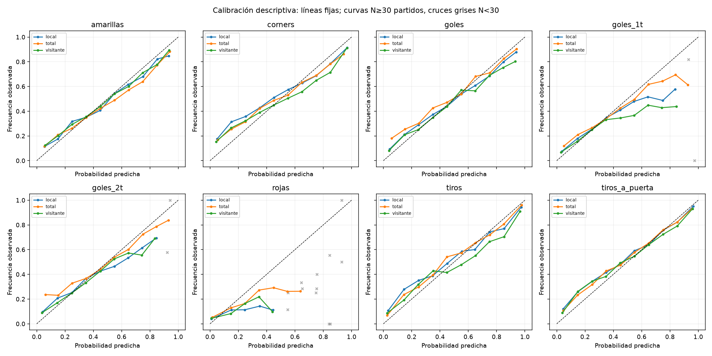
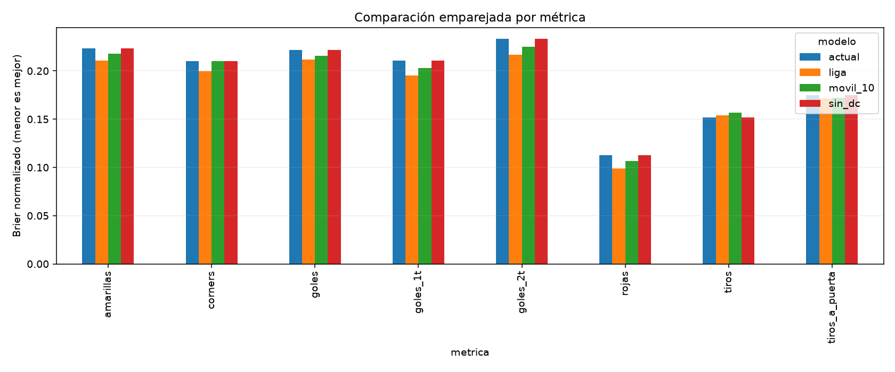
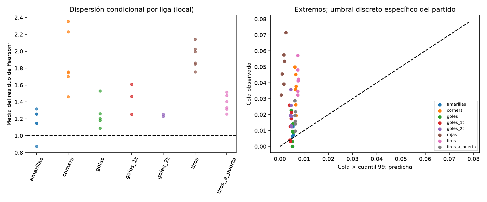
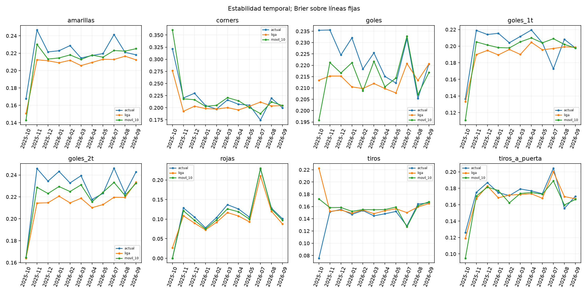

# Fase 2: validación histórica y calibración

## Resumen ejecutivo

Evaluación retrospectiva del algoritmo actual sobre 2197 partidos de seis ligas.
El entrenamiento excluye encuentros de la fecha evaluada y fechas posteriores. No se puede certificar
la disponibilidad original de cada estadística ni reproducir predicciones publicadas: no existen snapshots completos as-of.
No se modifica el modelo ni se activa calibración en producción.

En la muestra madura, líneas fijas y comparación emparejada, las diferencias de Brier frente a la
referencia de liga tienen IC descriptivo semanal completamente favorable para: **ninguna métrica**;
y desfavorable para: **amarillas, corners, goles, goles_1t, goles_2t, rojas, tiros_a_puerta**.
Los intervalos no están corregidos por múltiples comparaciones y no certifican generalización.
Un ranking predictivo no demuestra rentabilidad: no hay cuotas históricas verificables.

## Datos y cobertura

| liga | partidos | desde | hasta |
| --- | --- | --- | --- |
| bundesliga | 333 | 2025-08-22 | 2026-09-13 |
| laliga | 439 | 2025-08-15 | 2026-09-17 |
| ligamx | 243 | 2026-01-09 | 2026-09-19 |
| ligue1 | 342 | 2025-08-15 | 2026-09-13 |
| premier | 420 | 2025-08-15 | 2026-09-14 |
| seriea | 420 | 2025-08-23 | 2026-09-14 |

| liga | partidos | partidos_maduros |
| --- | --- | --- |
| bundesliga | 321 | 229 |
| laliga | 426 | 317 |
| ligamx | 233 | 140 |
| ligue1 | 331 | 243 |
| premier | 407 | 309 |
| seriea | 407 | 307 |

Datos completos para las métricas solicitadas. CSV y Excel son copias, no muestras adicionales.
Fuentes: football-data para Europa y ESPN para Liga MX. No se ha contrastado cada valor con la fuente.
Liga MX carece de metadatos que permitan certificar tiempo reglamentario y definición de tarjetas.
Sus resultados son diagnósticos, sujetos a esa reserva. No se imputan faltantes; datos corruptos detienen la ejecución.

## Metodología y prevención de fuga

- Corte por fecha de fuente, no por jornada estimada. Todos los encuentros del mismo día se excluyen del historial.
- XI=0.005, rho=-0.05, K_ENCOGE=0, sin ajustes.
- El modelo actual utiliza `modelo.fuerzas`, `modelo.lambdas` y `probabilidades.distribucion` de Fase 1.
- Las cuatro referencias comparten partidos y líneas; no se sustituyen equipos desconocidos dentro del modelo actual.
- Liga: medias históricas con pesos XI; móvil: últimos diez encuentros del equipo en la condición, sin ajuste por rival.
- Sin DC: mismas lambdas actuales, eliminando únicamente la corrección de las cuatro celdas de baja anotación.
- `fija` es una rejilla declarada en código antes de medir resultados. `defecto` reproduce configuración de la app;
  ambas banderas se registran. Tablas principales usan `fija`; las predicciones guardan también `defecto`.
- Muestra principal: ambos equipos con >=5 encuentros previos en la condición. Sensibilidad adicional exige n efectivo >=5.
- Partidos sin datos suficientes no se borran del registro; abstenciones y cobertura se exportan por separado.
- Las estadísticas de segundo tiempo del propio encuentro solo forman parte del objetivo observado.
- La calificación 0.6×probabilidad+0.4×historial de la app no se considera una probabilidad calibrada.

Brier se normaliza como ½Σ(p_k−y_k)²: coincide con Brier binario convencional y va de 0 a 1.
OU entero usa clases Under/Push/Over; BTTS usa No/Sí; 1X2 usa Visitante/Empate/Local.
Un empate de 1X2 no es devolución. Las curvas one-vs-rest incluyen la clase Push explícitamente.
Log Loss estricto es infinito si la clase observada tenía probabilidad cero. `logloss_clip` usa epsilon=1e-15
solo como diagnóstico finito; las tablas conservan ceros estructurales y el score estricto.
No se inventan cuotas ni se simula rentabilidad.

Las comparaciones bootstrap promedian líneas dentro del partido, emparejan modelos y remuestrean semanas
(1.000 réplicas, semilla fija). No cuentan cada línea como partido independiente. Wilson en curvas es
una referencia descriptiva por bin, no inferencia robusta ante correlación entre líneas o equipos.

## Comparación probabilística

| metrica | modelo | partidos | brier | logloss | ceros_observados |
| --- | --- | --- | --- | --- | --- |
| amarillas | actual | 1545 | 0.2231 | 0.7077 | 0 |
| amarillas | liga | 1545 | 0.2108 | 0.6707 | 0 |
| amarillas | movil_10 | 1545 | 0.2178 | 0.6913 | 0 |
| amarillas | sin_dc | 1545 | 0.2231 | 0.7077 | 0 |
| corners | actual | 1545 | 0.2100 | 0.6690 | 0 |
| corners | liga | 1545 | 0.1995 | 0.6273 | 0 |
| corners | movil_10 | 1545 | 0.2100 | 0.6633 | 0 |
| corners | sin_dc | 1545 | 0.2100 | 0.6690 | 0 |
| goles | actual | 1545 | 0.2216 | ∞ | 8 |
| goles | liga | 1545 | 0.2120 | 0.6757 | 0 |
| goles | movil_10 | 1545 | 0.2157 | ∞ | 8 |
| goles | sin_dc | 1545 | 0.2216 | ∞ | 8 |
| goles_1t | actual | 1545 | 0.2108 | ∞ | 80 |
| goles_1t | liga | 1545 | 0.1953 | 0.6249 | 0 |
| goles_1t | movil_10 | 1545 | 0.2027 | ∞ | 68 |
| goles_1t | sin_dc | 1545 | 0.2107 | ∞ | 80 |
| goles_2t | actual | 1545 | 0.2330 | ∞ | 79 |
| goles_2t | liga | 1545 | 0.2165 | 0.6833 | 0 |
| goles_2t | movil_10 | 1545 | 0.2252 | ∞ | 39 |
| goles_2t | sin_dc | 1545 | 0.2330 | ∞ | 79 |
| rojas | actual | 1545 | 0.1126 | ∞ | 458 |
| rojas | liga | 1545 | 0.0987 | 0.3574 | 0 |
| rojas | movil_10 | 1545 | 0.1065 | ∞ | 304 |
| rojas | sin_dc | 1545 | 0.1126 | ∞ | 458 |
| tiros | actual | 1545 | 0.1516 | 0.5107 | 0 |
| tiros | liga | 1545 | 0.1537 | 0.5088 | 0 |
| tiros | movil_10 | 1545 | 0.1565 | 0.5244 | 0 |
| tiros | sin_dc | 1545 | 0.1516 | 0.5107 | 0 |
| tiros_a_puerta | actual | 1545 | 0.1751 | 0.5636 | 0 |
| tiros_a_puerta | liga | 1545 | 0.1718 | 0.5505 | 0 |
| tiros_a_puerta | movil_10 | 1545 | 0.1722 | 0.5523 | 0 |
| tiros_a_puerta | sin_dc | 1545 | 0.1751 | 0.5636 | 0 |

Deltas negativos favorecen al modelo actual. Referencia de liga:

| metrica | referencia | partidos | bloques | delta_brier | ic95_lo | ic95_hi |
| --- | --- | --- | --- | --- | --- | --- |
| amarillas | liga | 1545 | 38 | 0.0123 | 0.0086 | 0.0163 |
| corners | liga | 1545 | 38 | 0.0105 | 0.0060 | 0.0150 |
| goles | liga | 1545 | 38 | 0.0096 | 0.0056 | 0.0133 |
| goles_1t | liga | 1545 | 38 | 0.0155 | 0.0118 | 0.0191 |
| goles_2t | liga | 1545 | 38 | 0.0165 | 0.0130 | 0.0202 |
| rojas | liga | 1545 | 38 | 0.0138 | 0.0106 | 0.0170 |
| tiros | liga | 1545 | 38 | -0.0021 | -0.0061 | 0.0018 |
| tiros_a_puerta | liga | 1545 | 38 | 0.0033 | 0.0000 | 0.0066 |

Otras comparaciones, ligas, líneas, lados y meses: archivos CSV de este directorio.
No compare directamente Brier de eventos muy raros con mercados equilibrados: use habilidad frente a referencia.

## Probabilidades superiores al 80%

Se toma el lado más probable entre Over/Under o Sí/No, exclusivamente para medias líneas y BTTS.
Estas selecciones están correlacionadas; se muestran también partidos únicos. Gap negativo indica sobreconfianza.

| metrica | partidos | selecciones | p_media | frecuencia | gap |
| --- | --- | --- | --- | --- | --- |
| amarillas | 1545 | 9805 | 0.8936 | 0.8533 | -0.0403 |
| corners | 1545 | 13845 | 0.9210 | 0.8457 | -0.0753 |
| goles | 1545 | 10356 | 0.9113 | 0.8657 | -0.0456 |
| goles_1t | 1545 | 8943 | 0.9277 | 0.8755 | -0.0521 |
| goles_2t | 1545 | 7436 | 0.9134 | 0.8502 | -0.0632 |
| rojas | 1520 | 5086 | 0.9639 | 0.9119 | -0.0520 |
| tiros | 1545 | 16962 | 0.9539 | 0.9140 | -0.0398 |
| tiros_a_puerta | 1545 | 18123 | 0.9261 | 0.8890 | -0.0371 |

## Distribuciones, errores y extremos

La likelihood conjunta usa el proceso Poisson/DC no truncado en logaritmos, evitando underflow de PMF;
las probabilidades de mercados usan el soporte condicionado de Fase 1 (cola <=1e-12).
Se registra cada observación fuera del soporte y cada probabilidad estructuralmente cero.
La dispersión condicional se estima con (observado−lambda)²/varianza predictiva; valores >1 sugieren
variación no explicada, pero también pueden reflejar errores en medias o incertidumbre de estimación.
No basta para concluir que binomial negativa será mejor. Para total con DC se incluye su cambio de varianza.
Las colas comparan excedencia del cuantil específico 95/99 de cada partido con su probabilidad exacta
(discreta, que no tiene por qué ser 5%/1%).

Diagnóstico local por liga del modelo actual:

| metrica | liga | partidos | mae | pearson_condicional | cola_99_real | cola_99_pred | ceros_estructurales_conjuntos |
| --- | --- | --- | --- | --- | --- | --- | --- |
| amarillas | bundesliga | 229 | 1.1494 | 1.3184 | 0.0131 | 0.0054 | 0 |
| amarillas | laliga | 317 | 1.1737 | 1.1483 | 0.0095 | 0.0057 | 0 |
| amarillas | ligamx | 140 | 1.2852 | 1.2557 | 0.0071 | 0.0055 | 0 |
| amarillas | ligue1 | 243 | 1.0606 | 1.1489 | 0.0123 | 0.0053 | 0 |
| amarillas | premier | 309 | 1.0623 | 1.2570 | 0.0065 | 0.0053 | 0 |
| amarillas | seriea | 307 | 0.9503 | 0.8724 | 0.0000 | 0.0052 | 0 |
| corners | bundesliga | 229 | 2.3729 | 1.7017 | 0.0262 | 0.0065 | 0 |
| corners | laliga | 317 | 2.3462 | 1.7562 | 0.0379 | 0.0066 | 0 |
| corners | ligamx | 140 | 2.5068 | 2.3545 | 0.0500 | 0.0062 | 0 |
| corners | ligue1 | 243 | 2.4298 | 2.2315 | 0.0453 | 0.0065 | 0 |
| corners | premier | 309 | 2.1070 | 1.4634 | 0.0194 | 0.0066 | 0 |
| corners | seriea | 307 | 2.3608 | 1.7455 | 0.0358 | 0.0064 | 0 |
| goles | bundesliga | 229 | 1.1382 | 1.2013 | 0.0087 | 0.0055 | 0 |
| goles | laliga | 317 | 0.9576 | 1.0889 | 0.0095 | 0.0051 | 0 |
| goles | ligamx | 140 | 1.1017 | 1.5318 | 0.0143 | 0.0053 | 0 |
| goles | ligue1 | 243 | 1.1364 | 1.2604 | 0.0000 | 0.0051 | 0 |
| goles | premier | 309 | 1.0168 | 1.1830 | 0.0032 | 0.0051 | 0 |
| goles | seriea | 307 | 0.9297 | ∞ | 0.0228 | 0.0046 | 2 |
| goles_1t | bundesliga | 229 | 0.7768 | ∞ | 0.0175 | 0.0046 | 4 |
| goles_1t | laliga | 317 | 0.6833 | ∞ | 0.0126 | 0.0042 | 2 |
| goles_1t | ligamx | 140 | 0.7363 | 1.6097 | 0.0214 | 0.0047 | 5 |
| goles_1t | ligue1 | 243 | 0.6922 | 1.4660 | 0.0041 | 0.0042 | 3 |
| goles_1t | premier | 309 | 0.7146 | 1.2519 | 0.0032 | 0.0044 | 3 |
| goles_1t | seriea | 307 | 0.6285 | ∞ | 0.0261 | 0.0038 | 6 |
| goles_2t | bundesliga | 229 | 0.8149 | 1.2306 | 0.0131 | 0.0046 | 1 |
| goles_2t | laliga | 317 | 0.8006 | ∞ | 0.0189 | 0.0047 | 4 |
| goles_2t | ligamx | 140 | 0.8422 | ∞ | 0.0357 | 0.0044 | 3 |
| goles_2t | ligue1 | 243 | 0.8831 | 1.2550 | 0.0123 | 0.0047 | 2 |
| goles_2t | premier | 309 | 0.7929 | ∞ | 0.0259 | 0.0045 | 2 |
| goles_2t | seriea | 307 | 0.7183 | ∞ | 0.0195 | 0.0043 | 4 |
| rojas | bundesliga | 229 | 0.1709 | ∞ | 0.0393 | 0.0016 | 21 |
| rojas | laliga | 317 | 0.2420 | ∞ | 0.0536 | 0.0019 | 27 |
| rojas | ligamx | 140 | 0.4473 | ∞ | 0.0714 | 0.0024 | 16 |
| rojas | ligue1 | 243 | 0.2035 | ∞ | 0.0576 | 0.0016 | 23 |
| rojas | premier | 309 | 0.0812 | ∞ | 0.0324 | 0.0005 | 25 |
| rojas | seriea | 307 | 0.1260 | ∞ | 0.0456 | 0.0009 | 27 |
| tiros | bundesliga | 229 | 3.8870 | 1.8486 | 0.0480 | 0.0073 | 0 |
| tiros | laliga | 317 | 3.8421 | 1.8619 | 0.0347 | 0.0073 | 0 |
| tiros | ligamx | 140 | 4.3224 | 2.1440 | 0.0571 | 0.0073 | 0 |
| tiros | ligue1 | 243 | 3.9699 | 1.9962 | 0.0412 | 0.0075 | 0 |
| tiros | premier | 309 | 3.7286 | 1.7576 | 0.0324 | 0.0074 | 0 |
| tiros | seriea | 307 | 4.0552 | 2.0252 | 0.0423 | 0.0076 | 0 |
| tiros_a_puerta | bundesliga | 229 | 1.9651 | 1.2566 | 0.0218 | 0.0064 | 0 |
| tiros_a_puerta | laliga | 317 | 1.8964 | 1.3315 | 0.0158 | 0.0063 | 0 |
| tiros_a_puerta | ligamx | 140 | 2.0682 | 1.5153 | 0.0143 | 0.0064 | 0 |
| tiros_a_puerta | ligue1 | 243 | 1.9507 | 1.4742 | 0.0288 | 0.0062 | 0 |
| tiros_a_puerta | premier | 309 | 1.8949 | 1.3151 | 0.0097 | 0.0062 | 0 |
| tiros_a_puerta | seriea | 307 | 1.9179 | 1.4044 | 0.0195 | 0.0062 | 0 |

## Calibración experimental temporal

Mapas Platt monótonos e isotónica PAVA, compartidos por métrica/lado/tipo entre ligas,
solo para medias líneas y BTTS. Se entrenan antes de cada mes evaluado, con embargo adicional de un día;
se requieren >=100 partidos únicos y >=20 partidos con cada clase en el entrenamiento.
Cada partido tiene peso total uno aunque aporte varias líneas. Under/No es complemento del Over/Sí calibrado;
se preserva monotonía entre líneas. No se calibran 1X2 ni OU con pushes mediante mapas binarios incoherentes.
Se comparan ambos candidatos, sin seleccionar ni activar automáticamente uno de ellos.

Comparación OOS mensual sobre exactamente las filas donde pudieron ajustarse ambos calibradores:

| metrica | modelo | partidos | selecciones | brier | logloss | logloss_clip | ceros_observados | pushes |
| --- | --- | --- | --- | --- | --- | --- | --- | --- |
| amarillas | actual | 1406 | 19684 | 0.1771 | 0.5363 | 0.5363 | 0 | 0 |
| amarillas | isotonica | 1406 | 19684 | 0.1778 | ∞ | 0.5523 | 11 | 0 |
| amarillas | platt | 1406 | 19684 | 0.1778 | 0.5347 | 0.5347 | 0 | 0 |
| corners | actual | 1406 | 23902 | 0.1794 | 0.5459 | 0.5459 | 0 | 0 |
| corners | isotonica | 1406 | 23902 | 0.1765 | ∞ | 0.5524 | 21 | 0 |
| corners | platt | 1406 | 23902 | 0.1759 | 0.5247 | 0.5247 | 0 | 0 |
| goles | actual | 1406 | 19684 | 0.1741 | 0.5247 | 0.5247 | 0 | 0 |
| goles | isotonica | 1406 | 19684 | 0.1724 | ∞ | 0.5259 | 6 | 0 |
| goles | platt | 1406 | 19684 | 0.1728 | 0.5174 | 0.5174 | 0 | 0 |
| goles_1t | actual | 1406 | 14060 | 0.1578 | ∞ | 0.5323 | 20 | 0 |
| goles_1t | isotonica | 1406 | 14060 | 0.1546 | ∞ | 0.4816 | 4 | 0 |
| goles_1t | platt | 1406 | 14060 | 0.1567 | 0.4806 | 0.4806 | 0 | 0 |
| goles_2t | actual | 1406 | 14060 | 0.1804 | ∞ | 0.5998 | 25 | 0 |
| goles_2t | isotonica | 1406 | 14060 | 0.1779 | ∞ | 0.5418 | 5 | 0 |
| goles_2t | platt | 1406 | 14060 | 0.1823 | 0.5455 | 0.5455 | 0 | 0 |
| rojas | actual | 1406 | 5284 | 0.1017 | ∞ | 1.3826 | 177 | 0 |
| rojas | isotonica | 1406 | 5284 | 0.0935 | 0.3295 | 0.3295 | 0 | 0 |
| rojas | platt | 1406 | 5284 | 0.0952 | 0.3375 | 0.3375 | 0 | 0 |
| tiros | actual | 1406 | 21090 | 0.1172 | 0.3834 | 0.3834 | 0 | 0 |
| tiros | isotonica | 1406 | 21090 | 0.1158 | ∞ | 0.3953 | 21 | 0 |
| tiros | platt | 1406 | 21090 | 0.1152 | 0.3646 | 0.3646 | 0 | 0 |
| tiros_a_puerta | actual | 1406 | 28120 | 0.1506 | 0.4644 | 0.4644 | 0 | 0 |
| tiros_a_puerta | isotonica | 1406 | 28120 | 0.1496 | ∞ | 0.4799 | 21 | 0 |
| tiros_a_puerta | platt | 1406 | 28120 | 0.1492 | 0.4565 | 0.4565 | 0 | 0 |

Período final declarado antes de ejecutar: desde 2026-07-01 (2026–27 europea / Apertura MX).
Los ajustes se siguen actualizando solo con meses anteriores; es evaluación prequential, no calibrador estático.
No se selecciona un método por sus resultados en este período.

| metrica | modelo | partidos | selecciones | brier | logloss | logloss_clip | ceros_observados | pushes |
| --- | --- | --- | --- | --- | --- | --- | --- | --- |
| amarillas | actual | 213 | 2982 | 0.1786 | 0.5407 | 0.5407 | 0 | 0 |
| amarillas | isotonica | 213 | 2982 | 0.1771 | ∞ | 0.5435 | 1 | 0 |
| amarillas | platt | 213 | 2982 | 0.1774 | 0.5342 | 0.5342 | 0 | 0 |
| corners | actual | 213 | 3621 | 0.1799 | 0.5463 | 0.5463 | 0 | 0 |
| corners | isotonica | 213 | 3621 | 0.1763 | ∞ | 0.5318 | 1 | 0 |
| corners | platt | 213 | 3621 | 0.1758 | 0.5238 | 0.5238 | 0 | 0 |
| goles | actual | 213 | 2982 | 0.1718 | 0.5134 | 0.5134 | 0 | 0 |
| goles | isotonica | 213 | 2982 | 0.1701 | 0.5093 | 0.5093 | 0 | 0 |
| goles | platt | 213 | 2982 | 0.1700 | 0.5087 | 0.5087 | 0 | 0 |
| goles_1t | actual | 213 | 2130 | 0.1520 | 0.4663 | 0.4663 | 0 | 0 |
| goles_1t | isotonica | 213 | 2130 | 0.1518 | 0.4639 | 0.4639 | 0 | 0 |
| goles_1t | platt | 213 | 2130 | 0.1511 | 0.4634 | 0.4634 | 0 | 0 |
| goles_2t | actual | 213 | 2130 | 0.1860 | 0.5569 | 0.5569 | 0 | 0 |
| goles_2t | isotonica | 213 | 2130 | 0.1832 | 0.5432 | 0.5432 | 0 | 0 |
| goles_2t | platt | 213 | 2130 | 0.1844 | 0.5450 | 0.5450 | 0 | 0 |
| rojas | actual | 213 | 852 | 0.1125 | ∞ | 0.6608 | 8 | 0 |
| rojas | isotonica | 213 | 852 | 0.1100 | 0.3678 | 0.3678 | 0 | 0 |
| rojas | platt | 213 | 852 | 0.1151 | 0.3864 | 0.3864 | 0 | 0 |
| tiros | actual | 213 | 3195 | 0.1286 | 0.4210 | 0.4210 | 0 | 0 |
| tiros | isotonica | 213 | 3195 | 0.1252 | ∞ | 0.3995 | 1 | 0 |
| tiros | platt | 213 | 3195 | 0.1242 | 0.3896 | 0.3896 | 0 | 0 |
| tiros_a_puerta | actual | 213 | 4260 | 0.1460 | 0.4469 | 0.4469 | 0 | 0 |
| tiros_a_puerta | isotonica | 213 | 4260 | 0.1448 | 0.4423 | 0.4423 | 0 | 0 |
| tiros_a_puerta | platt | 213 | 4260 | 0.1438 | 0.4400 | 0.4400 | 0 | 0 |

Las diferencias emparejadas e IC semanales se exportan en `calibradores_bootstrap*.csv`;
en esos archivos delta=actual−calibrador, de modo que positivo favorece al calibrador.
Las diferencias requieren consistencia por liga/mes y más temporadas. Las mejoras agregadas, por sí solas,
no autorizan instalar un calibrador. Los parámetros y los cortes de entrenamiento se guardan en `calibradores.json`.

## Ranking descriptivo de mercados

Ordena primero suficiencia (>=300 partidos, >=3 meses y >=20 observaciones de la clase minoritaria),
después habilidad frente a liga, calibración, estabilidad mensual y tamaño de muestra.
No mezcla esos criterios en una puntuación arbitraria ni declara rentabilidad. ECE es la media ponderada
de gaps absolutos por bin/clase en las curvas agrupadas; puede ocultar heterogeneidad entre ligas.
IC por familia/lado en `bootstrap_mercados.csv` acompañan al ranking sin corregir múltiples comparaciones.
En OU entero la clase minoritaria puede ser push; las líneas por partido no aumentan los partidos únicos.

| orden_descriptivo | metrica | kind | lado | partidos | skill_vs_liga | ece | fraccion_meses_mejor_liga | evidencia | ic95_lo | ic95_hi |
| --- | --- | --- | --- | --- | --- | --- | --- | --- | --- | --- |
| 1 | tiros | ou | local | 1545 | 0.0761 | 0.0479 | 1.0000 | exploratoria | -0.0203 | -0.0063 |
| 2 | tiros_a_puerta | ou | local | 1545 | 0.0317 | 0.0346 | 0.6364 | exploratoria | -0.0115 | 0.0004 |
| 3 | goles | 1x2 | total | 1545 | 0.0264 | 0.0602 | 0.8182 | exploratoria | -0.0180 | 0.0010 |
| 4 | tiros | ou | visitante | 1545 | 0.0181 | 0.0585 | 0.8182 | exploratoria | -0.0097 | 0.0035 |
| 5 | goles | ou | local | 1545 | -0.0095 | 0.0395 | 0.2727 | exploratoria | -0.0040 | 0.0076 |
| 6 | corners | ou | local | 1545 | -0.0232 | 0.0623 | 0.4545 | exploratoria | -0.0019 | 0.0113 |
| 7 | tiros_a_puerta | ou | visitante | 1545 | -0.0269 | 0.0431 | 0.0909 | exploratoria | -0.0005 | 0.0094 |
| 8 | goles_2t | 1x2 | total | 1545 | -0.0352 | 0.0833 | 0.1818 | exploratoria | 0.0040 | 0.0197 |
| 9 | tiros | ou | total | 1545 | -0.0403 | 0.0346 | 0.2727 | exploratoria | 0.0012 | 0.0094 |
| 10 | corners | ou | visitante | 1545 | -0.0446 | 0.0705 | 0.0909 | exploratoria | 0.0027 | 0.0151 |
| 11 | goles_1t | 1x2 | total | 1545 | -0.0470 | 0.0932 | 0.3636 | exploratoria | 0.0068 | 0.0236 |
| 12 | goles | ou | visitante | 1545 | -0.0488 | 0.0435 | 0.2727 | exploratoria | 0.0032 | 0.0162 |
| 13 | amarillas | ou | local | 1545 | -0.0502 | 0.0350 | 0.0909 | exploratoria | 0.0054 | 0.0160 |
| 14 | amarillas | ou | visitante | 1545 | -0.0545 | 0.0310 | 0.1818 | exploratoria | 0.0081 | 0.0152 |
| 15 | tiros_a_puerta | ou | total | 1545 | -0.0623 | 0.0348 | 0.1818 | exploratoria | 0.0061 | 0.0149 |
| 16 | goles_1t | ou | local | 1545 | -0.0647 | 0.0491 | 0.2727 | exploratoria | 0.0060 | 0.0174 |
| 17 | amarillas | ou | total | 1545 | -0.0666 | 0.0447 | 0.0000 | exploratoria | 0.0093 | 0.0190 |
| 18 | goles_2t | ou | visitante | 1545 | -0.0674 | 0.0500 | 0.0000 | exploratoria | 0.0075 | 0.0174 |
| 19 | goles_2t | ou | local | 1545 | -0.0726 | 0.0579 | 0.0909 | exploratoria | 0.0090 | 0.0199 |
| 20 | goles_1t | btts | total | 1545 | -0.0738 | 0.0934 | 0.2727 | exploratoria | 0.0074 | 0.0148 |
| 21 | goles | ou | total | 1545 | -0.0762 | 0.0445 | 0.0909 | exploratoria | 0.0106 | 0.0200 |
| 22 | goles_2t | btts | total | 1545 | -0.0808 | 0.0961 | 0.0909 | exploratoria | 0.0100 | 0.0232 |
| 23 | goles_1t | ou | total | 1545 | -0.0873 | 0.0515 | 0.1818 | exploratoria | 0.0147 | 0.0243 |
| 24 | corners | ou | total | 1545 | -0.0879 | 0.0574 | 0.0909 | exploratoria | 0.0120 | 0.0252 |
| 25 | goles_2t | ou | total | 1545 | -0.0946 | 0.0547 | 0.0909 | exploratoria | 0.0169 | 0.0289 |
| 26 | goles_1t | ou | visitante | 1545 | -0.0995 | 0.0602 | 0.2727 | exploratoria | 0.0108 | 0.0205 |
| 27 | goles | btts | total | 1545 | -0.1016 | 0.1111 | 0.0909 | exploratoria | 0.0156 | 0.0345 |
| 28 | rojas | ou | total | 1545 | -0.1274 | 0.0658 | 0.0909 | exploratoria | 0.0095 | 0.0181 |
| 29 | rojas | ou | local | 1545 | -0.1498 | 0.0669 | 0.0909 | exploratoria | 0.0095 | 0.0167 |
| 30 | rojas | ou | visitante | 1545 | -0.1527 | 0.0746 | 0.0909 | exploratoria | 0.0105 | 0.0180 |

## Visualizaciones






## Limitaciones y Fase 3

1. Prioridad máxima: registrar predicciones y cuotas con fixture_id estable, kickoff UTC completo,
   datos disponibles-as-of, versión del modelo, timestamp de captura, bookmaker, reglas y cuota de cierre.
   EV/ROI/yield/CLV/drawdown económicos no se calculan por falta de cuotas verificables.
2. Obtener varias temporadas con procedencia y revisiones conservadas; validar especialmente ESPN y tarjetas.
3. Evaluar candidatos de calibración con más bloques temporales y estabilidad por liga antes de adoptar uno.
4. Investigar medias y dispersión de tiros/tiros a puerta/tarjetas; comparar binomial negativa fuera de muestra
   si el diagnóstico condicional lo justifica. Priorizar eventos raros y lambdas cero: una binomial negativa con media cero tampoco resuelve esos ceros.
   Evaluar encogimiento con validación temporal antes de atribuir todo el error a Poisson; no ajustar aquí.
5. El período final es pequeño por liga. IC bootstrap son descriptivos y hay múltiples comparaciones;
   el estudio no equivale a datos prospectivos inéditos ni a validación económica.
6. No se reconstruye calendario/jornada oficial ni disponibilidad de la información antes del kickoff.
   Los snapshots actuales podrían incorporar correcciones posteriores. Los cortes evitan usar filas futuras,
   pero no prueban la ausencia de revisiones históricas.

## Reproducción

```bash
python -m pip install -r requirements-dev.txt
python -m evaluacion --salida docs/fase2 --procesos 2 --guardar-predicciones
python -m pytest -q
```

No hay dependencias nuevas: pandas/numpy/scipy/matplotlib ya pertenecen a la aplicación.
`--guardar-predicciones` genera CSV gzip de mercados y conteos; los registros completos son artefactos
regenerables y no se versionan. Se versionan tablas, gráficas, parámetros y manifest con hashes de entrada.
Semillas, período final y parámetros se fijan en la CLI. No hay descargas ni escrituras en servicios externos.
