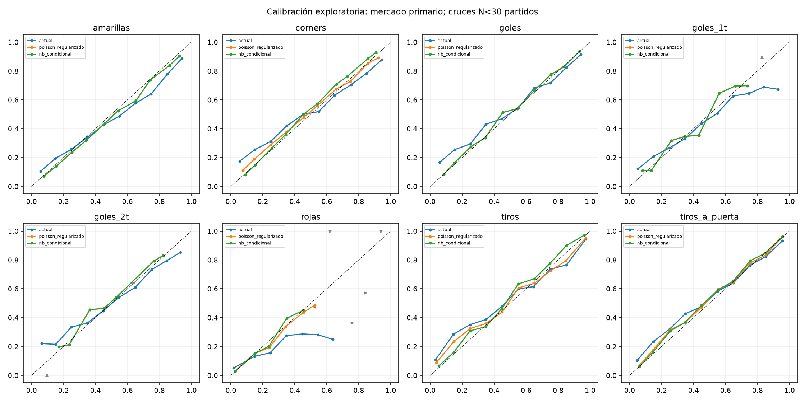
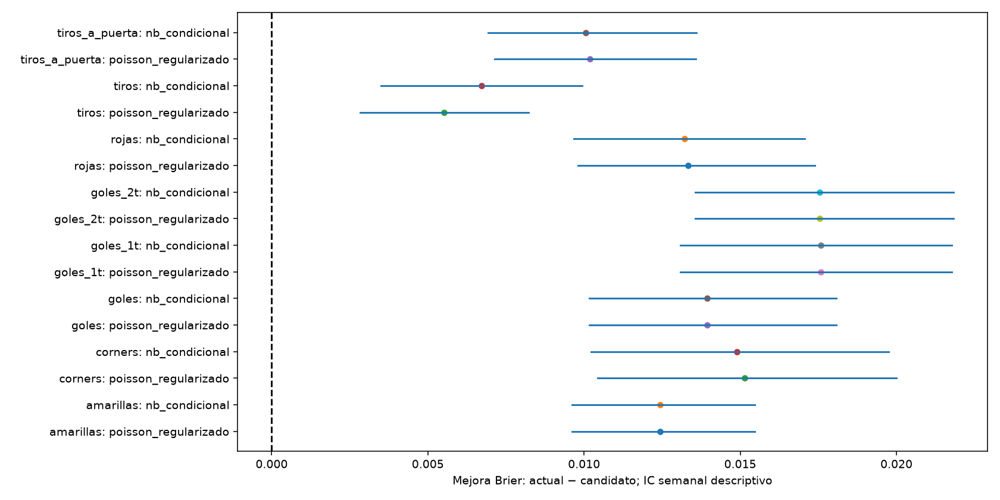
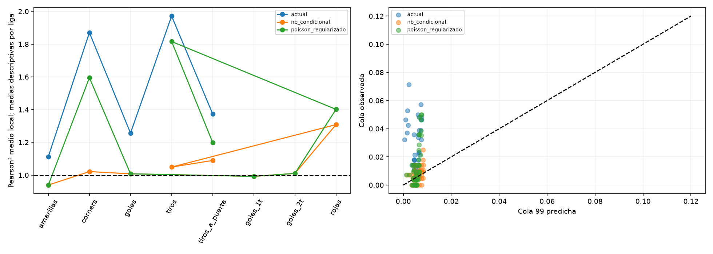
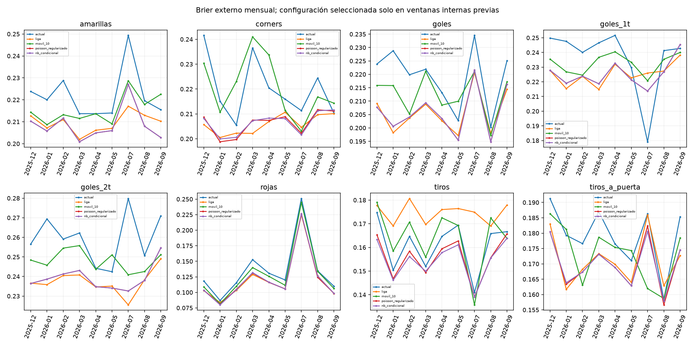

# Fase 3 — Regularización y dispersión experimental

## Dictamen

Se conserva el modelo vigente. Ningún candidato se activa en producción y no se modifica la interfaz
ni el motor de liquidación. Los resultados son **exploratorios retrospectivos**, no evidencia independiente
ni rentabilidad demostrada. El histórico ya fue examinado en Fase 2 y motivó estos experimentos.
Los candidatos de la tabla son estrategias seleccionadas internamente, no ganadores escogidos con los meses externos.

## Datos y cohortes

2197 partidos históricos; 1406 partidos externos evaluables,
1,505,826 filas entre 7 modelos sobre exactamente las mismas claves y objetivos.
Se exige la cohorte madura y líneas fijas de Fase 2. Meses sin validación interna suficiente se omiten
para todos los comparadores y quedan en `seleccion_poisson.json`. Un fallo parcial de ejecución aborta
el informe en lugar de mejorar el score mediante exclusiones. La muestra es condicional al historial.

| liga | partidos | desde | hasta |
| --- | --- | --- | --- |
| bundesliga | 216 | 2025-12-05 00:00:00 | 2026-09-13 00:00:00 |
| laliga | 283 | 2025-12-01 00:00:00 | 2026-09-17 00:00:00 |
| ligamx | 140 | 2026-03-07 00:00:00 | 2026-09-19 00:00:00 |
| ligue1 | 208 | 2025-12-05 00:00:00 | 2026-09-13 00:00:00 |
| premier | 279 | 2025-12-02 00:00:00 | 2026-09-14 00:00:00 |
| seriea | 280 | 2025-12-01 00:00:00 | 2026-09-14 00:00:00 |

No hay disponibilidad original certificada ni snapshots completos de revisiones históricas. Liga MX
requiere contraste adicional de definiciones. CSV y Excel no son muestras independientes.

## Protocolo temporal anidado

Cada lambda del banco se estima con datos de fechas anteriores al partido. Antes de cada mes externo,
se comparan scores de predicciones diarias OOS de los tres meses internos previos, excluyendo el día
anterior al inicio del mes. Se requieren >=100 partidos y >=2 meses internos. Se minimiza Brier primario
macro por liga y se desempata por ID declarado; nunca se utilizan objetivos externos para seleccionar.

Objetivo interno: OU local en tiros; OU total en tiros a puerta, goles/1T/2T, amarillas, córners y rojas.
La rejilla comprende kappa={1,3,10,20}, xi={0,.005,.01}, ventana={todo,180 días}. En goles y 1T se
compara rho={0,-.05}; se añaden dos controles de encogimiento directo. No se reajusta la rejilla al ver
los resultados. La selección es compartida entre ligas, pero cada media usa exclusivamente su liga histórica.

Las medias de liga usan prior Gamma(0.5,0.5), declarado, y cada componente recibe kappa exposiciones
hacia esa media positiva. Es regularización con exposición fraccionaria, no certificación de cobertura bayesiana.
El encogimiento directo usa el mínimo de exposiciones de ambos equipos y la lambda actual.
`regularizado_sin_dc` mantiene las lambdas seleccionadas y elimina DC como ablación controlada.

## Poisson antes de binomial negativa

El piloto se ejecutó antes del banco completo; sus resultados de coste están en `piloto.json`.
Se persistieron selección y residuos Poisson en `seleccion_poisson.json` y `poisson_previo.json` antes de estimar NB.
Solo se habilita NB en un corte para tiros/tiros a puerta/córners/amarillas/rojas cuando el residuo Pearson
medio **interno OOS** supera 1.2 y hay >=30 observaciones positivas. Nunca se usa la dispersión del mes
externo para habilitarlo. Hay 28 cortes habilitados de 72 selecciones.

NB2 conserva las medias Poisson seleccionadas y estima alpha en [0,2] por likelihood de los conteos
internos OOS. Su varianza es lambda+alpha×lambda². Si no cumple el diagnóstico o no mejora la likelihood
interna frente a alpha=0, vuelve a Poisson; `nb_condicional` denota esa estrategia causal, no NB en todos
los partidos. Se comparten alpha por métrica/corte; sus diferencias por liga se diagnostican por separado.
No se combina NB con la corrección DC diseñada para Poisson. `nb_vs_poisson.csv` mide el efecto
incremental de cambiar la distribución sobre las mismas lambdas seleccionadas, con IC por bloques;
es diagnóstico, no un mecanismo para seleccionar ganadores externos.

## Comparación por mercado primario

Mejora positiva favorece al candidato. No se elige retrospectivamente el mejor entre Poisson y NB.
Se presentan ambos y se conservan las referencias de liga y móvil.

| mercado | candidato | partidos | brier_actual | brier_candidato | brier_liga | brier_movil | mejora_brier | logloss_actual | logloss_candidato | mejora_logloss | evidencia |
| --- | --- | --- | --- | --- | --- | --- | --- | --- | --- | --- | --- |
| amarillas OU total | poisson_regularizado | 1406 | 0.2191 | 0.2066 | 0.2083 | 0.2131 | 0.0124 | 0.6955 | 0.6591 | 0.0364 | evidencia insuficiente |
| amarillas OU total | nb_condicional | 1406 | 0.2191 | 0.2066 | 0.2083 | 0.2131 | 0.0124 | 0.6955 | 0.6591 | 0.0364 | evidencia insuficiente |
| corners OU total | poisson_regularizado | 1406 | 0.2210 | 0.2058 | 0.2054 | 0.2230 | 0.0151 | 0.7057 | 0.6560 | 0.0497 | evidencia insuficiente |
| corners OU total | nb_condicional | 1406 | 0.2210 | 0.2061 | 0.2054 | 0.2230 | 0.0149 | 0.7057 | 0.6557 | 0.0500 | evidencia insuficiente |
| goles OU total | poisson_regularizado | 1406 | 0.2176 | 0.2037 | 0.2036 | 0.2119 | 0.0139 | 0.6964 | 0.6548 | 0.0416 | evidencia insuficiente |
| goles OU total | nb_condicional | 1406 | 0.2176 | 0.2037 | 0.2036 | 0.2119 | 0.0139 | 0.6964 | 0.6548 | 0.0416 | evidencia insuficiente |
| goles_1t OU total | poisson_regularizado | 1406 | 0.2431 | 0.2255 | 0.2242 | 0.2334 | 0.0176 | 0.7754 | 0.7171 | 0.0583 | evidencia insuficiente |
| goles_1t OU total | nb_condicional | 1406 | 0.2431 | 0.2255 | 0.2242 | 0.2334 | 0.0176 | 0.7754 | 0.7171 | 0.0583 | evidencia insuficiente |
| goles_2t OU total | poisson_regularizado | 1406 | 0.2565 | 0.2390 | 0.2378 | 0.2490 | 0.0175 | ∞ | 0.7534 | ∞ | evidencia insuficiente |
| goles_2t OU total | nb_condicional | 1406 | 0.2565 | 0.2390 | 0.2378 | 0.2490 | 0.0175 | ∞ | 0.7534 | ∞ | evidencia insuficiente |
| rojas OU total | poisson_regularizado | 1406 | 0.1220 | 0.1087 | 0.1088 | 0.1151 | 0.0133 | ∞ | 0.3810 | ∞ | evidencia insuficiente |
| rojas OU total | nb_condicional | 1406 | 0.1220 | 0.1088 | 0.1088 | 0.1151 | 0.0132 | ∞ | 0.3814 | ∞ | evidencia insuficiente |
| tiros OU local | poisson_regularizado | 1406 | 0.1626 | 0.1571 | 0.1746 | 0.1672 | 0.0055 | 0.5445 | 0.5182 | 0.0263 | exploratoria favorable |
| tiros OU local | nb_condicional | 1406 | 0.1626 | 0.1559 | 0.1746 | 0.1672 | 0.0067 | 0.5445 | 0.5084 | 0.0362 | exploratoria favorable |
| tiros_a_puerta OU total | poisson_regularizado | 1406 | 0.1787 | 0.1686 | 0.1694 | 0.1750 | 0.0102 | 0.5831 | 0.5501 | 0.0330 | evidencia insuficiente |
| tiros_a_puerta OU total | nb_condicional | 1406 | 0.1787 | 0.1687 | 0.1694 | 0.1750 | 0.0101 | 0.5831 | 0.5506 | 0.0325 | evidencia insuficiente |

Log Loss estricto conserva infinito cuando el observado tenía probabilidad cero. Los intervalos de
Log Loss solo se calculan cuando **todas** las diferencias son finitas; no se eliminan filas infinitas
para obtener una comparación favorable. El diagnóstico recortado es separado y no decide la selección.

## Incertidumbre, multiplicidad y estabilidad

Se promedian líneas por partido y se remuestrean semanas completas con 2.000 réplicas y semilla fija.
Las columnas IC95 son descriptivas; se añade sensibilidad con bloques de 14 días (`ic95_14d_*`). El contraste bilateral de diferencias usa cambios de signo por
bloque semanal; Holm ajusta una familia de 42 contrastes primarios (mercados,
estrategias y referencias actual/liga/móvil). Los diagnósticos por línea, liga, BTTS y 1X2 no son
confirmatorios. La independencia aproximada de semanas no elimina toda dependencia entre equipos.

Etiqueta exploratoria favorable exige >=300 partidos, >=12 semanas, IC favorable y p Holm<=.05 frente
a las tres referencias, sin empeorar Log Loss frente al actual, mejora en >=70% de meses y >=2/3 de ligas.
Es una regla descriptiva predefinida, no permiso para instalar un modelo. El resto es evidencia insuficiente.
Las tablas por liga/mes incluyen tamaño de muestra; no convierten varias líneas en partidos independientes.

| metrica | candidato | partidos | bloques | mejora_brier | ic95_lo | ic95_hi | p_holm | logloss_ic95_lo | logloss_ic95_hi |
| --- | --- | --- | --- | --- | --- | --- | --- | --- | --- |
| amarillas | poisson_regularizado | 1406 | 33 | 0.0124 | 0.0096 | 0.0155 | 0.0210 | 0.0284 | 0.0453 |
| amarillas | nb_condicional | 1406 | 33 | 0.0124 | 0.0096 | 0.0155 | 0.0210 | 0.0284 | 0.0453 |
| corners | poisson_regularizado | 1406 | 33 | 0.0151 | 0.0104 | 0.0200 | 0.0210 | 0.0346 | 0.0647 |
| corners | nb_condicional | 1406 | 33 | 0.0149 | 0.0102 | 0.0197 | 0.0210 | 0.0350 | 0.0656 |
| goles | poisson_regularizado | 1406 | 33 | 0.0139 | 0.0102 | 0.0181 | 0.0210 | 0.0304 | 0.0534 |
| goles | nb_condicional | 1406 | 33 | 0.0139 | 0.0102 | 0.0181 | 0.0210 | 0.0304 | 0.0534 |
| goles_1t | poisson_regularizado | 1406 | 33 | 0.0176 | 0.0131 | 0.0218 | 0.0210 | 0.0424 | 0.0734 |
| goles_1t | nb_condicional | 1406 | 33 | 0.0176 | 0.0131 | 0.0218 | 0.0210 | 0.0424 | 0.0734 |
| goles_2t | poisson_regularizado | 1406 | 33 | 0.0175 | 0.0136 | 0.0218 | 0.0210 | — | — |
| goles_2t | nb_condicional | 1406 | 33 | 0.0175 | 0.0136 | 0.0218 | 0.0210 | — | — |
| rojas | poisson_regularizado | 1406 | 33 | 0.0133 | 0.0098 | 0.0174 | — | — | — |
| rojas | nb_condicional | 1406 | 33 | 0.0132 | 0.0097 | 0.0171 | — | — | — |
| tiros | poisson_regularizado | 1406 | 33 | 0.0055 | 0.0028 | 0.0082 | 0.0210 | 0.0154 | 0.0380 |
| tiros | nb_condicional | 1406 | 33 | 0.0067 | 0.0035 | 0.0099 | 0.0210 | 0.0211 | 0.0512 |
| tiros_a_puerta | poisson_regularizado | 1406 | 33 | 0.0102 | 0.0071 | 0.0136 | 0.0210 | 0.0231 | 0.0441 |
| tiros_a_puerta | nb_condicional | 1406 | 33 | 0.0101 | 0.0069 | 0.0136 | 0.0210 | 0.0220 | 0.0442 |

## Likelihood, residuos, calibración y colas

`conteos.csv` presenta likelihood conjunta no truncada, sesgo, RMSE, Pearson² y colas 95/99 por liga,
modelo y lado. Para total se utiliza la suma de varianzas y la covarianza DC; NB mantiene independencia.
Las probabilidades OU Poisson marginales/totales son analíticas. NB total usa convolución con cola
excluida <=1e-12; se registran soporte y observaciones fuera de él. Las medias positivas evitan ceros
estructurales de los candidatos; no se fuerza epsilon para ocultar limitaciones del modelo actual.

`calibracion*.csv` contiene bins one-vs-rest, incluidos pushes. ECE y Wilson son descriptivos por selecciones
correlacionadas, no inferencia independiente. `confianza_80.csv` muestra sobreconfianza de lados favoritos.
No se instala ni se selecciona un calibrador nuevo. `dixon_coles.csv` compara las mismas lambdas
seleccionadas con su rho interno frente a rho=0; sus intervalos son diagnósticos y no forman parte
de la familia confirmatoria. Valores infinitos de Pearson no se dibujan, pero se conservan en CSV.

## Evidencia independiente y registro prospectivo

La evaluación independiente permanece **pendiente**. Julio–septiembre de 2026 ya se examinó en Fase 2:
no puede presentarse como holdout inédito. Tras congelar código/configuración, se deben registrar
predicciones antes del kickoff para partidos futuros; no se cambiarán hiperparámetros usando ese período.

`experimentos.registro` ofrece CLI opt-in y SQLite append-only con ID idempotente, timestamps UTC,
commit, modelo, lambdas, probabilidades y hashes de archivos realmente suministrados. Rechaza datos
posteriores a la generación y registros después del kickoff. La cadena detecta alteraciones ordinarias;
no sustituye firmas externas ni certifica timestamps declarados por el proveedor. No se conecta a producción.
No se han capturado predicciones reales futuras ni cuotas como parte de este backtesting.

## Figuras






## Reproducción

```bash
python -m experimentos --piloto
python -m experimentos --etapa poisson --procesos 2
python -m experimentos --etapa nb --procesos 2
python -m pytest -q
```

Se necesita el caché verificable Fase 2: `python -m evaluacion --guardar-predicciones --procesos 2` si no
está disponible. Los bancos gzip son regenerables y no se versionan; parámetros, informes y hashes sí.
No se inventan cuotas ni se calculan ROI, CLV o rentabilidad. Producción conserva el modelo vigente.
